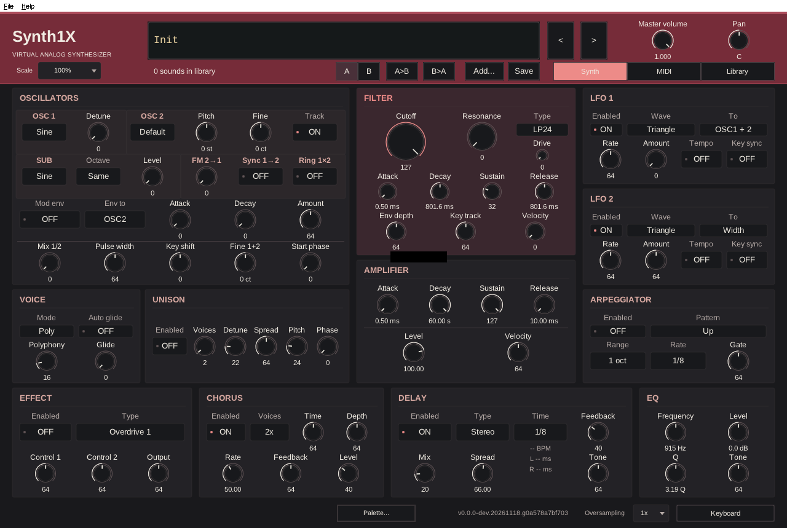
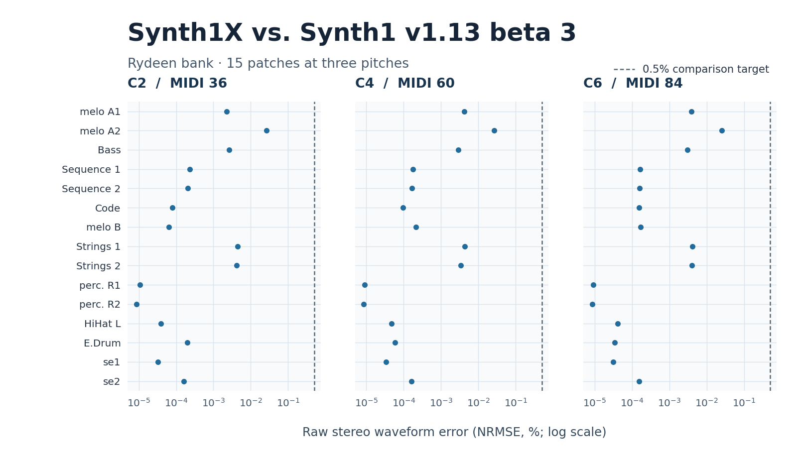
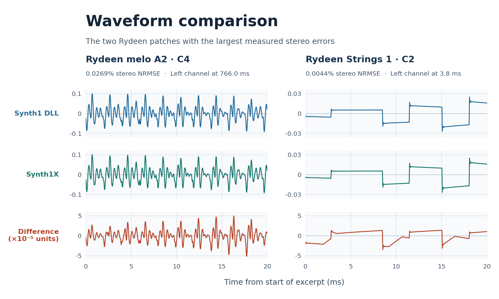

# Synth1X

Synth1X is a free, open-source virtual analog subtractive synthesizer with
Synth1-compatible patch loading. Shape sounds in a single panel and organize
them in a searchable library with tags and favorites. Synth1X starts with Init
and an empty library. Add your own `.sy1` files or browse patches directly in
ZIP, RAR and 7z banks.

## Synth engine

- **Sound sources** — two main oscillators and a sub oscillator, with noise,
  pulse-width modulation, FM, hard sync and ring modulation.
- **Tone and modulation** — resonant low-pass, high-pass, band-pass and diode
  filters, filter and amplifier ADSR envelopes, an oscillator modulation
  envelope, and two LFOs with tempo and key sync.
- **Performance** — up to 32 polyphonic voices, with unison drawing from the
  same voice pool. Mono and legato modes, glide, and a tempo-synced arpeggiator.
- **Output** — multi-effects, chorus, delay, EQ, and selectable oversampling up
  to 16×.

The editor has dedicated MIDI and Library views, and A/B slots for comparing
two sounds. [Editor and library guide](docs/gui/README.md)

## Platforms and formats

| Platform | Plugin formats | Standalone |
| --- | --- | --- |
| Windows | VST3, CLAP | APP |
| macOS (Apple Silicon) | VST3, CLAP, AUv2 | APP |
| Linux (experimental) | VST3, CLAP | APP |

These are configured build targets, not certification of plugin/DAW operation.
See [capabilities and verification boundaries](docs/status.md) for the current scope.

## Install native packages

See [INSTALL.md](INSTALL.md) for Linux/Windows/macOS product locations, unsigned-build
prompts and plugin rescanning. Find published packages under
[Releases](https://github.com/yasuyuki-baba/synth1x/releases) and native candidates
in successful [GitHub Actions runs](https://github.com/yasuyuki-baba/synth1x/actions).
Source archives require building.

Upgrading from Synth2 0.1.x to Synth1X 0.2.x or later requires manual migration.
See the [migration guide](MIGRATION.md) before upgrading.

## Synth1 audio comparison

All 15 patches in the official Rydeen bank were rendered with Synth1 and
Synth1X at C2, C4 and C6. Across the 45 comparisons, the largest normalized
stereo waveform error (NRMSE) was **0.027%**. Even in that case, the difference
signal had about **1/3,700** of the Synth1 reference's RMS amplitude, or
**71 dB below** the reference RMS. The 99 compared patch controls matched in
every run.

Each dot is one patch at one pitch. The same logarithmic scale is used in all
three panels, with smaller errors toward the left.

### Waveform excerpts

For each of the two highest-error patches, the figure shows the 20 ms window
with the largest RMS difference in the left channel. The two source traces in
each column share a vertical scale. The bottom row shows Synth1X minus Synth1 on
a finer scale. The NRMSE labels use the full stereo renders.
[Results and test conditions](docs/validation/reference-comparisons.md#rydeen-bank-comparison)

## Development

Build from source and run the tests with the [development guide](DEVELOPMENT.md).

## License

SPDX-License-Identifier: GPL-3.0-or-later

Synth1X's project-owned source code is free software: you can redistribute it and/or
modify it under the terms of the GNU General Public License as published by the
Free Software Foundation, either version 3 of the License, or (at your option)
any later version.

It is distributed in the hope that it will be useful, but WITHOUT ANY WARRANTY;
without even the implied warranty of MERCHANTABILITY or FITNESS FOR A PARTICULAR
PURPOSE. See [LICENSE](LICENSE) for the complete terms.

Third-party components and fonts retain their own licenses and notices. This grant
does not establish redistribution rights for separately authored user patches
or historical assets; see the
[distribution requirements](docs/publication/README.md).
