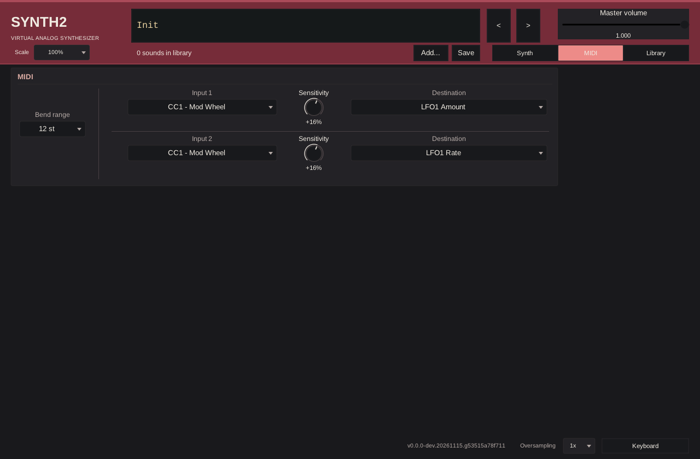

# Editor behavior and visual contract

Ordinary sound design belongs on one Synth surface with Synth1-inspired functional
groups. Oscillators occupy the wider left column above adjacent Voice and Unison
panels. Filter and Amplifier share the center column; the two LFOs stack above
ARP in the right column.
Effects and EQ occupy the bottom. Pan remains in the persistent header beside
Master volume on every view. Allocate panel space by control density
rather than forcing every column into identical row heights. Ordinary knobs
retain similar readable sizes; Cutoff remains the dominant larger control.

MIDI uses one compact panel with ordinary Pitch Bend range on the left and two
aligned controller assignment rows on the right, separated by thin dividers.
Keep selector widths close to their content rather than stretching every row
across the editor. Bend range offers the supported 0–24 semitones; imported values
outside this menu remain Custom without rewriting saved words or narrowing the
historical 0–127 host range. Pitch Bend range is independent of selecting
Pitch Bend as a routing input, and remains part of the sound. Each assignment row
contains a named Input selector, continuous Sensitivity knob and named Destination
selector. Inputs are CC1–CC11, channel aftertouch and pitch bend, stored as their
original MIDI source words. Destinations are grouped by synthesis/effect section
to keep menus within the editor; None stays at the root. Destinations retain
their source parameter IDs; None stores -1. Sensitivity displays signed -100% to +100%, with source dials
63–64 neutral; numeric entry still edits the original 0–127 source dial. These
assignments belong to the sound, rather than a global MIDI Learn map.
The historical host destination range remains 0–127; named editor edits and sound
state preserve the disabled -1 sentinel independently of the host projection.
Displaying imported assignments or synchronizing host values must not edit them.



The image is a native Linux CLAP editor capture at 100% scale.

Serialized metadata and reserved fields stay outside the editor; their host IDs,
patch values and state serialization remain supported.
There is no Advanced tab. Preset browsing and master
volume remain visible. The header also offers persistent [A/B sound comparison](patch-comparison.md)
for patch audition and sound editing. The supplementary [Library view](patch-library.md) accumulates
imported sounds and combines bank, tag, keyword and favorite filters.
Use the Library tab for explicit view switching rather than a duplicate Library
action button. Clicking the current patch name also opens the Library view.
Keyword search belongs in the Library view; the persistent header does not
duplicate its text input. Search and filter state remain intact across view changes.
View transitions invalidate the complete editor, including its background, after
updating control visibility. Repainting must not invoke parameter edits or sound
loading actions.

Typography uses shared logical sizes: 12 for auxiliary text, 13 for values,
14 for parameter labels and bank/tag metadata, 15 for controls, headings and list
titles, 16 for text entry and SDK menus, and 19 for the selected patch title. Native
bank/tag popups retain the platform's standard menu typography. Secondary controls
stay quiet through color and placement rather than tiny type. Choice values use
measured ellipsis at a fixed size, with full values in tooltips; Random smooth
uses the short display name Rnd smooth. Source words and saved controls are unchanged.
The standard 1280-by-840 view remains supported. Knob label/value bands reserve
space for the larger text. Panel side padding is 8 units and controls start 38
units below the panel top. Both LFOs use a selector row followed by Rate, Amount,
Tempo and Key sync, with full-size Rate/Amount knobs. Chorus uses three full-width
lower-row columns.
Use Synth1's original functional groupings as a reference while retaining the
larger Nord Lead 2-inspired Cutoff and its filter emphasis. Oscillator rows frame
OSC1 and OSC2 side by side, with OSC1-based Sub and a separate interaction frame
below. OSC1 groups Wave/Detune; OSC2 groups Wave/Pitch/Fine/Track. Sub groups
Wave/Octave/Level. FM (OSC2 to OSC1), Sync (OSC1 to OSC2) and Ring (OSC1 times OSC2)
share the interaction frame. The waveform selectors carry OSC1/OSC2/Sub headings,
and interaction labels show the oscillator relationships. Mod Env and shared
mix/tuning controls remain below those frames; Pulse width, shared Fine and Start phase
labels distinguish their scope from OSC2 tuning. Tooltips explain Sub's OSC1/Mix
dependency, Ring's priority over FM, and phase settings that apply at note-on.
Voice sits directly below the
oscillators, with Mode/Auto glide above Polyphony/Glide. Adjacent Unison keeps
Enabled, Voices, Detune, Spread, Pitch and Phase in one centered row. Both LFOs
retain a selector row and full-size lower knobs in the right column. Amplifier separates
ADSR from level/velocity. EQ arranges Frequency/Level and Q/Tone in two compact rows. The bottom row distributes width by control density, keeping ordinary knob
spacing close across Effect, Chorus, Delay and EQ. Time retains its tempo and
stereo-delay readout directly below it. Muted rose headings and thin internal dividers
provide hierarchy without reducing label sizes or moving controls off the main
surface. Native drawing and review studies share group frames, dividers and delay readout bounds;
studies use placeholders for live tempo and stereo delay times.
Native drawing and review tools consume the shared typography policy.

Window-frame resizing scales the complete logical canvas, including text and
input hit areas, rather than enlarging an unscaled drawing area. Standalone and
plugin views on every platform use the largest uniform scale that fits both
parent-supplied dimensions, subject to the 0.5–4 scale limits. A resize notification
never requests another parent-window resize. Different parent and canvas aspect
ratios leave unused space rather than stretching or clipping the canvas. This
policy applies equally to ordinary dragging, maximization and tiling layouts.
The corner handle also scales the UI. Both paths retain the scale when the
software keyboard changes the logical height. Platform pixel scaling is accounted
for separately. Bounds below the minimum scaled canvas
size cannot contain the full canvas at the supported minimum scale.

The header groups **Master volume** and **Pan** as matching round knobs, aligned
at the label, indicator and value bands. Master volume retains the 0–1 gain
readout with three decimal places. Pan shows C at source value 64 and L/R percentages on either side;
clicking its readout still edits the original 0–127 source value. Both controls
remain visible on Synth, MIDI and Library. Moving Pan does not change host IDs,
patch values, A/B ownership or its existing DSP placement. The lower panel is
labelled EQ and retains its Tone knob.

The persistent header places **Scale** below the logo on the left, so it stays
accessible when an enlarged view extends beyond the screen. The library sound
count is below the patch display, aligned with its left edge. The footer groups
**Oversampling** and **Keyboard** on the right, beside the version label.
Oversampling and Scale use a bordered value field with a dropdown arrow; Scale
uses a light header label and Oversampling a muted footer label. Oversampling keeps the current multiplier visible and opens the
existing 1x/2x/4x/8x/16x quality menu on click; it does not accept text entry.
Quality remains available
in every view; moving it does not change processing, latency or session recall.

**Scale** is an editable percentage with a dropdown arrow. The arrow offers
50/75/100/125/150/175/200%; clicking the numeric value accepts direct input from
50 to 400%, including decimals and an optional percent sign. Enter commits and
Escape cancels; invalid or out-of-range input preserves the current view.
100% means the logical editor size before OS DPI scaling. Requests preserve the
canvas aspect ratio. Standalone requests are limited to the desktop work area;
the WM or plugin host owns the accepted parent bounds. If the requested size is
adjusted or refused, the canvas fits the actual bounds and the field shows the
accepted scale, rounded to one decimal place. Frame/corner resizing and keyboard
height changes update that readout too. The scale remains available in every
view and survives closing/reopening the editor within the same instance. It is
not a sound parameter, an automation parameter or part of serialized patch/project
state; a new instance requests 100% within its available bounds.

The footer's **Keyboard** toggle opens/closes the software keyboard on every
view. It starts closed; opening increases the logical editor height from 840 to
936 while retaining the current display scale. This is an editor control, not a
sound parameter or a saved patch value. The background covers the full logical
editor bounds after every resize, including the keyboard margins.

While open and focused, PC keys `A W S E D F T G Y H U J K O L` play chromatically
from MIDI note 48 at velocity 127, matching CheapSynth01. `Z`/`X` lower/raise the
base by an octave within MIDI notes 24–96. Held PC keys are released before an
octave change; key repeat does not retrigger notes or repeatedly change octaves.
Ctrl/Command/Alt shortcuts remain available. Text entry releases and suspends PC
notes. Hiding the keyboard, losing editor focus or closing the editor releases
PC notes and the mouse key retained by the standard control.

The on-screen keyboard uses iPlug2's `IVKeyboardControl` for drawing, hit testing,
dragging and velocity. Mouse and PC notes enter the framework's
`SendMidiMsgFromUI()` queue and reach the same `ProcessMidiMsg()` path as host
MIDI. PC note messages also update the standard control through
`SendMidiMsgFromDelegate()`; incoming host MIDI uses the framework's UI delivery.
There is no separate ownership arbitration for mouse, PC and external notes of
the same pitch: ordinary MIDI note-on/off ordering applies. Keyboard input is
transient and never enters patch/session sound state.

Use restrained red accents, warm-white legends and black controls, with subtle
Nord Lead 2 influence and Synth1X's own identity. Prioritize high-use controls,
especially cutoff; do not invent unsupported instrument features to match a panel.
Bundle editor fonts so installed font families cannot change the layout.

Named selectors write actual source integers while preserving host IDs/ranges.
For example, chorus choices write 1/2/4. Opening the editor must not normalize
noncanonical values: show Default/Custom where appropriate. Numeric editing uses
source values; units are presentation only. Nominal envelope durations are not
measured note lengths. Context-dependent parameters retain source readouts until
an accurate unit conversion is available.

Host and editor numeric editing use integer steps for discrete selections,
quantized tuning, counts and MIDI source/destination words. Continuous dials
retain fractional values, including fine tuning and route sensitivity. Envelope,
fine-tuning and EQ unit readouts use the fractional dial
position rather than rounding to an adjacent integer first. Unit readouts remain
presentation only; numeric entry and host automation use the original source
scale. See the [processor contract](../contracts/processor-state.md).

`EditorLayout`, `EditorAppearance`, `EditorValueDisplay` and the exporter provide
shared native/preview geometry, appearance and value displays. Failed library
reads or invalid source loads preserve valid state. State recall retains source
text and its patch display name and does not require the source ZIP. UI notifications must not sweep imported
values through native setters and thereby change loading history.

The SDK-independent presentation headers live in `projects/Synth2/src/editor`
under `synth2::editor`; `src/host` owns the processor/state and catalog boundaries.
The header audit compiles each presentation header independently and rejects
dependencies on host/engine objects or iPlug2. `ParameterPresentation` is shared
with native host parameter registration without depending on ProcessorBridge.

The native adapter is split by responsibility: `Synth2Editor.cpp` coordinates
layout, page visibility and editor lifetime; `editor/EditorControls` owns drawing
and control input; `editor/Synth2LibraryEditor.cpp` owns catalog/menu/dialog actions
and host notification after a successful sound transaction. The native keyboard
focus helper checks the editor view on Windows/macOS; `ComputerKeyboard` owns the
SDK-independent PC key map and release behavior. The standard iPlug2 keyboard
owns mouse interaction; ProcessorBridge receives only MIDI messages. Shared
native tags and appearance helpers keep layout and library updates consistent. Catalog, selection
and dialog lifetime remain owned by the plugin wrapper. Controls borrow them. Both native
build paths consume the same editor source list.

```sh
cmake --preset core
cmake --build build-oos-core --target ExportEditorLayout
python3 tools/preview_editor.py --exporter build-oos-core/ExportEditorLayout
python3 tools/render_editor_study.py --exporter build-oos-core/ExportEditorLayout
```

These commands generate local studies at `build/editor/synth1x-preview.html` and
`build/editor/synth1x-study.svg`; open those files to inspect the design. Generated
studies are excluded from Git. On Windows, use
`build-oos-core/ExportEditorLayout.exe` as the exporter path. Optional PNG output
adds `--png` to the study command and requires discoverable librsvg, Cairo and
GObject shared libraries; SVG/HTML generation does not require those libraries.
The optional PNG is another local generated export alongside the SVG.

The HTML preview illustrates the main synthesis controls; the persistent Library
view is covered by the native editor and portable catalog tests. The preview has
no audio engine or complete versioned loading resolver. SVG
and PNG studies are design renderings, not native plugin screenshots. Native
focus, scaling, DAW interaction and platform accessibility need platform testing.
See [EditorLayoutTest.cpp](../../tests/EditorLayoutTest.cpp), the patch-library tests
and [native APP capture](../validation/manual-platform.md#native-windows-app-capture).

The generated layout study and interactive preview are presentation aids governed
by this contract, not audio/DAW validation.

Momentary editor actions use the shared native ActionButtonControl, which starts
the SDK completion animation before invoking application code. Click feedback
must return to idle even when a menu or dialog captures the release event.
Tab and source-selection controls retain their independent selected-state behavior.

Delay Time uses host-synchronized note choices while preserving source values on
patch/state recall. The Delay panel displays the playback tempo and current left
and right tap times in milliseconds, including Spread, buffer limits and tempo
glides. The readout is audio-thread telemetry; before processing it is unavailable.

## Palette editing

The footer's **Palette...** button opens one modeless native window per editor.
The main surface stays available for preview and sound design. The palette window
and its entry button use fixed, opaque colors so a transparent or low-contrast
palette cannot hide the recovery controls. Reopening the palette window raises
the existing window without replacing its cancellation baseline.

All palette roles stay visible in a fixed two-column color grid while editing.
Related colors appear as left/right pairs, with small gaps between surfaces,
text, controls/state and the display/keyboard colors:

| Left | Right |
| --- | --- |
| Background | Border |
| Header | Header edge |
| Panel | Inner panel |
| Text | Secondary text |
| Group heading | Inner heading |
| Control | Control edge |
| Track | Pointer |
| Accent | Selection |
| Display | Display text |
| White keys | |

General and group scopes use exactly the same cell order and positions. In group
scopes, roles restricted to General keep their slots but appear dimmed and cannot be
selected or edited. Each cell shows its role, a checkerboard-backed color swatch
and RGBA value. Only explicit group overrides carry a **Custom** badge; inherited
and unavailable roles have no extra cell labels or legend. Clicking a
cell selects it for the adjacent color picker/HEX/RGBA editor without hiding the
other colors or changing their values.

**General** sets shared colors. Each Synth group and the MIDI group can override
its panel, inner panel, headings, text, borders, accents and control colors
independently. Unset group colors inherit General; **Use General** clears the
selected override and **Reset group** clears all overrides in that group.
The built-in appearance remains the only supplied palette. Its Filter panel and
heading are ordinary default overrides, not special rendering branches.

Colors accept `#RRGGBB` or `#RRGGBBAA`, a native color picker, RGB sliders/values
and opacity from 0–100%. The bottom canvas is always opaque. Transparent layers
compose above it; window/desktop transparency is not supported. Group palettes also apply to their labels, selectors and knobs;
General applies to the header, library, popup menus and software keyboard.

**Choose image...** selects an 8-bit PNG or JPEG background for the main surface below
the header, including Synth, MIDI and Library. The header never displays the image,
even when its colors are transparent. The image is centered and scaled to cover the
area below the header while retaining its aspect ratio; edges may be cropped. It sits
above the opaque Background color and below all panels and controls, so panel
opacity determines how much shows through. **Remove image** previews its removal.
Selection/removal share the color edit's Apply, Cancel and discard confirmation.
The palette window and recovery button retain their fixed appearance. Default
colors resets only colors and group overrides, keeping the chosen image.

Images are limited to 8 MiB, 8192 pixels per side and 16 megapixels. Selection and
native palette loading/import fully decode images before replacing the preview;
an unreadable or invalid image reports an error and preserves the current palette.
Encoded image bytes are embedded in preferences and exports, so moving or deleting
the original image does not break the saved appearance. No external path is needed.
Color-only files retain version 1; files with embedded images use version 2.

**Import...** and **Export...** in the palette window exchange the complete
palette as XML: General colors, every group's explicit overrides, alpha values
and the optional embedded background image. Importing a color-only palette clears
the current background image.
The exchange format is the same versioned format as `palette.xml` preferences.
New files use the `<Palette>` root. Synth1X also reads older `<Synth2Palette>`
files. Apps from before the rename require the old root to import a palette.
Import validates the selected file before replacing the preview; Apply is still
needed to activate it as the saved user preference. Missing, malformed, oversized
or unsupported imports report an error without changing the current preview or
its cancellation baseline. Cancelling the file chooser changes nothing.

Export writes the current draft, including valid pending text edits and unsaved
changes, to the chosen file. It does not Apply the palette or clear unsaved-change
confirmation. The default export name is `Synth1X-palette.xml`; an omitted extension
gets `.xml`. Replacing an existing file requires confirmation. An export failure
keeps editing available and reports the error in the fixed-color window.

Edits preview only in the owning instance. **Apply** atomically saves the palette
in `palette.xml` in the `Synth1X` user settings directory. Other instances read the
saved preference when their editors are next opened. Missing preferences restore
the built-in appearance, including when the file was deleted while an editor was closed. Sound changes, A/B and DAW
state recall do not change the palette or publish host parameter changes.
**Cancel** and the palette window close button ask **Discard palette changes?**
when the current colors or inheritance overrides differ from the opening palette.
**Keep editing** dismisses the fixed-color confirmation and retains the preview;
**Discard changes** closes the palette window and restores its opening palette.
Escape or Return in the confirmation keeps editing. Selection-only actions and
edits reverted to the opening values close without confirmation. A valid text
entry still in progress is committed to the preview before checking for changes.
Closing the main editor or unloading the plugin still restores the opening
palette directly, since host-driven teardown cannot be vetoed by a child editor.
**Default colors** asks **Restore default colors?** before replacing all General
colors and group overrides with the built-in appearance. Cancel, Escape and Return
keep the current preview. An already-default palette needs no confirmation.
The reset previews immediately after confirmation and is saved only by Apply. A failed save keeps the window open with an error and
preserves the cancellation baseline. Invalid saved preferences leave the current
palette intact and report the error in the editor status.

Palette preferences use a versioned XML document with stable role/group keys and
explicit RGBA values. They are UI-only data, separate from sound/session state.
See `EditorPaletteTest.cpp` for color parsing, inheritance, instance isolation,
transaction rollback and preference persistence/rejection checks. Native window
focus, color picker and host-specific window behavior belong to manual platform
validation.
